<div align="center">

# Playtrace

Discover AI-made games, follow their progress, and share what you would pay

[![Live][badge-site]][url-site]
[![HTML5][badge-html]][url-html]
[![CSS3][badge-css]][url-css]
[![JavaScript][badge-js]][url-js]
[![Claude Code][badge-claude]][url-claude]
[![License][badge-license]](LICENSE)

[badge-site]:    https://img.shields.io/badge/live_site-0063e5?style=for-the-badge&logo=googlechrome&logoColor=white
[badge-html]:    https://img.shields.io/badge/HTML5-E34F26?style=for-the-badge&logo=html5&logoColor=white
[badge-css]:     https://img.shields.io/badge/CSS3-1572B6?style=for-the-badge&logo=css3&logoColor=white
[badge-js]:      https://img.shields.io/badge/JavaScript-F7DF1E?style=for-the-badge&logo=javascript&logoColor=black
[badge-claude]:  https://img.shields.io/badge/Claude_Code-CC785C?style=for-the-badge&logo=anthropic&logoColor=white
[badge-license]: https://img.shields.io/badge/license-MIT-404040?style=for-the-badge

[url-site]:   https://playtrace.neorgon.com/
[url-html]:   #
[url-css]:    #
[url-js]:     #
[url-claude]: https://claude.ai/code

</div>

---

## Overview

Playtrace collects games shared on r/aigamedev so players can discover a project, inspect its source history, and follow its progress. Makers get nonbinding willingness-to-pay feedback without turning the catalogue into a payment service.

**Live:** [playtrace.neorgon.com](https://playtrace.neorgon.com/) · **API:** [service status](https://playtrace-api.neorgon.workers.dev/api/v1/status)

## Features

- **Source-linked discovery** -- Real previews, genre and development-stage filters, maker views, search, grid/list layouts, and shareable project links.
- **Project histories** -- Updates join an existing game only when author and canonical project link match. Sharing an author alone never merges games.
- **Ongoing collection** -- A Cloudflare collector resumes bounded archive windows, keeps ambiguous candidates for review, and reports actual coverage. Automatic entries are labeled source-described.
- **Following** -- Signed-in users keep a private list of games to revisit for updates.
- **Price feedback** -- One editable USD response from $0 to $100 per account and game. Medians and distributions appear after five accounts respond. These are opinions, not bids to purchase or payment commitments.
- **Account protections** -- Server-verified Clerk sessions, account and network rate limits, private individual responses, and a delete-my-data control. Accounts and shared networks cannot prove distinct people.
- **Managed previews** -- R2 can store bounded, validated images with a recorded creator permission. Initial previews remain at their original hosts. Removal hides a game immediately and cleans up its stored data and media.

The initial reviewed snapshot contains 90 games and 96 source posts. The live catalogue grows separately. No votes, demand figures, or user accounts are seeded.

## Running locally

There is no frontend build step. From this directory:

```bash
make serve
```

Open `http://localhost:8900`. `js/config.js` pins the API address. To explore the bundled snapshot without a backend, set `apiBase` to an empty string in your local checkout. Account features will then be unavailable. A configured API failure never switches silently to the bundled snapshot.

The Worker uses Cloudflare D1 and R2. See [the Worker configuration](worker/wrangler.jsonc), [the database migration](worker/migrations/0001_initial.sql), and [the API modules](worker/src/index.mjs). Production credentials belong in Worker secrets, never in `js/config.js`, a commit, or browser storage. Local secrets belong in an ignored `worker/.dev.vars` file. Authenticated browser testing requires an HTTPS origin permitted by both Clerk and `ALLOWED_ORIGINS`.

## Verification

```bash
node --test tests/*.test.mjs
node --test worker/tests/*.test.mjs
python3 worker/tests/schema.test.py
```

Client tests cover source validation, shared filters, price parsing, and challenge cancellation. Backend tests use synthetic signed sessions, a SQLite-backed D1 adapter, and controlled archive/media responses. Use a Node runtime with `node:sqlite`. They cover rejection of forged identity, uniqueness, price thresholds, rate limits, resumable collection, atomic imports, removal, and media validation. They do not manufacture activity in the live database.

## Architecture



[Editable diagram](docs/architecture.mmd)

| Area | Files | Responsibility |
| --- | --- | --- |
| Browser shell | `index.html`, `css/collection.css`, `css/report.css` | Accessible browsing and source-history dialogs |
| Client behavior | `js/state.js`, `js/render.js`, `js/events.js` | Validated collection state, filtering, navigation, rendering |
| Account client | `js/api.js`, `js/accounts.js`, `js/challenge.js` | Pinned API requests, authenticated follows and price responses |
| Collection | `worker/src/archive.mjs`, `worker/src/ingestion.mjs` | Archive normalization, conservative categorization, cursors and scheduling |
| Trust and storage | `worker/src/auth.mjs`, `worker/src/limits.mjs`, `worker/src/store.mjs`, `worker/src/media.mjs` | Identity, quotas, D1 records and consented R2 previews |
| Initial data | `data/catalog.json` | Dated, reviewed source snapshot for local exploration and initial import |

The interface uses pale slate, navy type, and warm amber actions, with system dark preference support. Archivo headings and Source Sans 3 body text are self-hosted with their font licenses. `css/report.css` owns the visual layer; vendored Neorgon kits provide shared header, footer, auth, persistence, and navigation behavior.

## Collection and trust boundaries

Arctic Shift is a third-party archive and may be delayed or incomplete. Original Reddit posts remain the primary source. A listed author, game stage, or AI-use claim is not independently verified. Clear showcases can publish automatically; ambiguous candidates require operator review. Earlier posts that would change a stable game identity are retained for review rather than silently merged.

Production uses explicit `account-rate-limit` protection. An operator can enable strict Turnstile verification by configuring its server secret, site key, hostname, and protection mode together. Missing or unknown protection configuration fails closed. Individual prices and network keys are never returned by public aggregate routes.

The initial API caps the published catalogue at 2,000 games and bounds each game's source history. Add pagination and a review interface before approaching those limits. Public preview storage is not an open upload endpoint.

## Possible next steps

- A creator claim flow that proves control through the original Reddit account.
- A private daily digest of followed projects with a new demo or release.
- A prediction game for upcoming releases, with scores kept separate from willingness-to-pay responses.

---

<div align="center">
<sub>Part of <a href="https://neorgon.com/">Neorgon</a></sub>
</div>
